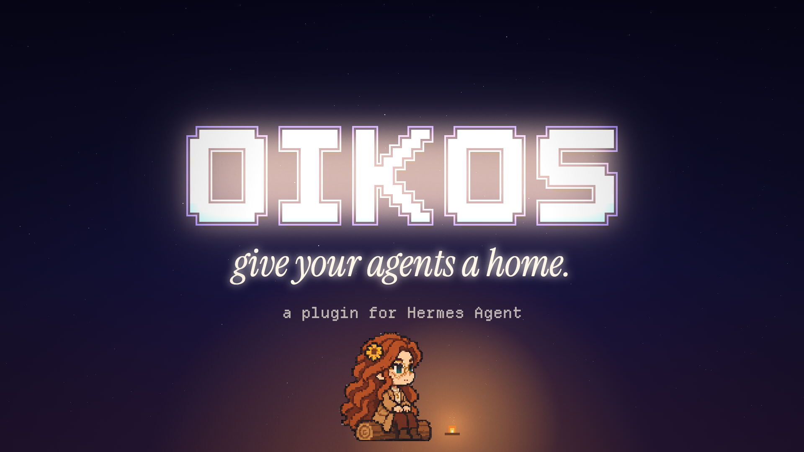

# Oikos



Oikos is a pixel habitat page for **Hermes Desktop**. Each of your Hermes profiles becomes a resident
with a home of its own, routines and a place on a 9-district map. Live gateway activity (turns,
tool use, subagents, approval prompts) shows up as residents walking to stations. Everything runs
locally inside the Desktop app.

> **Status: 0.1.0, early.** It has been tested on Hermes 0.23.2 (a development build). No minimum Hermes
> version is declared yet. See [Known limitations](#known-limitations).

The world is drawn with pixel art by **[LimeZu](https://limezu.itch.io/)** (Modern Exteriors, Modern
Interiors and Character Generator 2.0). The art is LimeZu's and is **not** covered by this
repository's MIT code licence. See [THIRD_PARTY_NOTICES.md](THIRD_PARTY_NOTICES.md).

## Install

**From the Hermes plugin catalog** (once the listing is merged):

```bash
hermes plugins install oikos
```

Or install **Oikos** from the Marketplace in Hermes Desktop. Oikos is a Desktop-only package (it has no
agent half). After installing, make sure the Desktop switch on the Oikos row in **Settings → Plugins**
is on. Then open **Oikos** from the sidebar, the `❖ Oikos` chip in the status bar, or ⌘K →
`Oikos: Open living pixel habitat`.

**From a clone of this repository** (Node ≥ 22). The committed `desktop/plugin.js` is the full build,
art included, so building is optional:

```bash
npm ci
npm test                 # Node tests, including a byte-for-byte rebuild check of desktop/plugin.js
npm run install:plugin   # copies desktop/plugin.js to $HERMES_HOME/desktop-plugins/oikos/plugin.js
```

`install:plugin` keeps any earlier copy in `$HERMES_HOME/plugin-backups/`, and
`node scripts/install.mjs --remove` uninstalls. Reload Hermes Desktop if Oikos does not appear.

## What it touches (privacy disclosure)

- **Plugin SDK surfaces:** one route (`/oikos`), a sidebar row, a ⌘K command and a status bar chip, all
  through `@hermes/plugin-sdk`. It has no agent tools, hooks, middleware, env vars, Python backend,
  OAuth or credentials.
- **Reads, through the SDK only:**
  - your profile list, from `host.profiles.list()` (or, while the gateway socket is `'open'`, the
    `profiles.list` gateway RPC; plus `host.profileRoutes()` for extra routes). It keeps each
    profile's name, display name and description to make one resident per profile. The description is
    shown in Oikos but is **never sent to a model** (see below);
  - the state atoms `host.state.gateway` (socket state; usable means `'open'`), `profile`,
    `focusedSessionId`, `activeSessionId` and `busy`. Sessions show up as `Session <first 8 characters
    of the runtime id>`; no session title is read;
  - gateway events from `host.onEvent('*')`: `message.start/delta/interim/complete`,
    `reasoning.delta/available`, `thinking.delta`, `tool.generating/start/progress/complete`,
    `subagent.spawn_requested/start/progress/thinking/tool/complete`,
    `approval.request/settled/cancelled`, `clarify.request/settled`, `error` and `gateway.ready`.
    From these Oikos uses **only** the event type, the session id, the profile tag, the tool's
    **name** (e.g. `read_file` becomes "Reading files") and the subagent id/index. It never reads tool
    arguments, previews, results, file paths, commands, message or reasoning text, or subagent goals.
    Subagent workers are removed on `subagent.complete`, at the end of the turn (`message.complete` or
    `error`) or after a timeout. Replayed frames from a reconnect never spawn workers.
- **Stores, in the plugin's own `ctx.storage` only:** world state (residents, chronicle, artifacts,
  projects, packs, the model-mind setting and its spend counters). This includes text **you type** in
  Oikos (chat lines to residents, station tasks, citizen names, personas and seeded memories) and
  short activity labels built from tool names. Nothing is written anywhere else.
- **Model requests: only if you opt in** (off by default). Exactly what is sent, and what is never
  sent, is listed under [Model use](#model-use).
- **Network, shell, background:** none of `fetch`, WebSocket or EventSource is in the shipped bundle.
  There are no shell commands, no telemetry and no self-updater. While Hermes Desktop is open, a
  simulation loop runs; it moves residents and asks for decisions only while the Oikos page is
  visible. Audio is procedural Web Audio and muted by default.

## Model use

**Off by default: out of the box Oikos makes no model requests.** Residents are driven by a built-in
deterministic scheduler (daily phases, needs, utility scoring).

You can opt in to an optional **model mind** in the Chronicle tab: **Use a model…** shows what will be
sent and that it can cost money, and nothing changes until you press **Enable model mind**. Your choice
is saved in the plugin's `ctx.storage`, and **Turn model mind off** stops all requests. While it is on:

- **How it calls.** About every 3 minutes while the Oikos page is visible, and when you press **Step
  Mind Now**, Oikos sends one request through the SDK's `host.request` to Hermes's gateway method
  `llm.oneshot`. That is the stateless one-shot method Hermes Desktop itself uses for titles and project
  ideas. Oikos sends exactly `instructions`, `input`, `max_tokens`, `temperature` and
  `task: "oikos_mind"`. It sends **no `session_id`**, so no chat session's model, history or transcript
  is involved.
- **Which model, and who pays.** Hermes picks the model for the `oikos_mind` task from
  `auxiliary.oikos_mind` in your `config.yaml`. If that isn't set, Hermes uses its automatic choice,
  which can be your main model. Calls are billed to whatever provider that resolves to. To keep costs
  down, pin a cheap model:

  ```yaml
  auxiliary:
    oikos_mind:
      provider: openrouter
      model: vendor/cheap-model-id
  ```

- **What a request contains** (for up to six residents per request):
  - name: your Hermes profile names or display names, or the name you typed for a citizen you created;
  - persona: the built-in text for the example residents, or the persona **you typed** for a citizen
    you created. A Hermes profile's description is replaced by the fixed text `Hermes profile resident`;
  - title, home district, preferred activity, mood (one of four words), needs (three numbers), item ids
    and earned specialties;
  - up to 3 earlier notes that **the model itself wrote** in previous replies, or fixed Oikos notes
    such as `Routine (workday): visited Desk`;
  - station ids, districts and kinds, the time, the weather and, during a gathering, its station id.
- **What is never sent:** anything you type in chat with a resident, station tasks you assign,
  memories you type into a citizen, gathering titles, Hermes profile descriptions, memories saved by
  an older Oikos build (they carry no record of where they came from), and anything from your Hermes
  sessions: messages, reasoning, tool names or arguments, file paths, commands and results. The tests
  check this with planted secrets (`tests/sdk-contract.test.mjs`).

  Text that is sent is sanitised against prompt injection. A model reply can only choose a station,
  one of four moods, a short speech line and a short memory, and is validated against the world's real
  station ids.
- **Budget.** You choose the limits in the Chronicle tab. The defaults are 10 requests per clock hour,
  about 20,000 estimated tokens per UTC day and 260 reply tokens per request. The highest values the
  settings accept are 20 requests an hour and 50,000 estimated tokens a day. These are **Oikos's own
  counters, not a spending cap**: Hermes and your provider enforce none of them, and the cases below
  can let real usage exceed them. `llm.oneshot` returns no usage figures, so token counts are
  **estimates**, deliberately on the high side (characters ÷ 3). Before each request Oikos reserves
  the prompt estimate plus the full reply allowance and only sends if that fits.
  - **The counters persist.** The charge is written to `ctx.storage` and read back **before** the
    request is sent. A reload, a plugin re-enable or an app restart does not reset the hour or the
    day, and a reload in the middle of a request keeps it charged. Windows that share the Desktop's
    storage share the counters.
  - **One request in flight, across reloads.** The same write records an in-flight lease (which
    runtime sent it, valid for 90 seconds, longer than the 60-second timeout Oikos gives
    `host.request`). A runtime created by a reload or re-enable sends nothing while another runtime's
    lease is live; a closed runtime never releases its lease, so it simply expires. The lease bounds
    what Oikos waits for, not what the gateway does: a model call Hermes already started may still
    finish (and be billed) after Oikos stopped waiting. A reply that arrives after its Oikos page
    was closed, reloaded or disabled is discarded and writes nothing.
  - **Failures count in full.** A failed or timed-out request may still have been billed, so its whole
    reservation stays charged. A successful one is settled to its estimate.
  - **Fails closed.** If the write cannot be confirmed (storage full or disabled), no request is sent.
    If the saved counters are present but unreadable (including bytes that are no longer valid JSON,
    which Hermes's `ctx.storage` reports exactly like a missing key; Oikos keeps a separate marker key
    to tell the two apart), the current hour and day are treated as used up, and the counters are
    rewritten so the next hour and day open normally. Not caught: a counter that was already
    corrupt before this version first marked it, or the counter and the marker both lost at once;
    either reads as fresh counters, the same as clearing storage.
  - If a host gives Oikos no storage at all, the counters are per runtime, and the Chronicle tab says
    the limits reset when Oikos reloads.
- **Fallback.** Every failure falls back to the deterministic scheduler for that step, so residents
  keep moving: an error from Hermes, an empty reply, or a reply with no valid decisions. While the
  gateway socket is not `'open'`, a step is skipped and not charged. The Chronicle tab shows the last
  outcome. If the gateway doesn't have `llm.oneshot` at all
  (JSON-RPC `-32601`), Oikos stops asking until you turn the mind on again.

**How this relates to Hermes's plugin model API.** Hermes's documented way for a plugin to call a model
is `ctx.llm`, from the plugin's Python half, on an auxiliary task the plugin registers. Oikos is
Desktop-only and has no Python half, so it does not use that route. Instead it relies on the
general-purpose gateway RPC that `host.request` exposes ("everything the app itself calls"). As a result:

- `oikos_mind` is not a registered task, so it does not appear in the Models settings pickers. It is
  still read from `config.yaml` like any `auxiliary.<task>` key.
- `llm.oneshot` is an app-internal method, not a plugin contract. A future Hermes could change it,
  and if it does, Oikos falls back as described above.

## Known limitations

- **The model mind is lightly proven.** It was tested against a mock host that applies the gateway's
  own `llm.oneshot` parameter checks, not against a live model. No paid call was made while preparing
  this release. Resident decisions from a real model have not been checked for quality.
- **Tested against the SDK contract, not a live Desktop.** The tests build their hosts and events from
  `tests/fixtures/hermes-sdk-contract.json`, which `scripts/extract-sdk-contract.mjs` extracted from
  hermes-agent `da9c2bd`. `HERMES_AGENT_SRC=/path/to/hermes-agent npm test` also fails if the fixture
  has drifted from that checkout. This release has not been run in a live Hermes Desktop.
- **Spend limits are estimates, per machine, and not a hard cap.** Token counts are estimated from
  characters, and Hermes may retry a model call internally, so one counted request can be billed more
  than once. Clearing the Desktop's local storage (or removing both the counter and its marker key)
  resets the counters. The counters and the in-flight lease live in `localStorage`, which has no
  atomic compare-and-set: two Desktop windows deciding in the same instant could each send one request
  before seeing the other's charge. Within one window (including reloads and re-enables) the lease
  prevents a second concurrent request.
- No minimum Hermes version is declared. The SDK slots used (`ROUTES_AREA`, `SIDEBAR_NAV_AREA`,
  `PALETTE_AREA`, `STATUSBAR_AREAS`, `ctx.onDispose`, `ctx.storage`) exist in recent Hermes Desktop
  builds, and older ones are untested.
- One district is themed on Philadelphia's Rittenhouse Square (public landmarks, as world flavour).
- `src/transport.js` also has an unused stub for a future remote mode, which uses `fetch` and
  `EventSource`. Only the local transport is imported, so esbuild leaves the remote stub out of
  `desktop/plugin.js`.

## Build and reproducibility

`desktop/plugin.js` is the only file Hermes Desktop loads. It is built from `src/` by esbuild (version
locked in `package-lock.json`). The six sprite sheets are embedded in it as base64 PNG data URLs.

```bash
npm run build            # rebuild desktop/plugin.js from src/, carrying the embedded art over
npm run verify:bundle    # rebuild into a temp file and compare bytes with the committed bundle
npm run check:release    # pre-publish gate: art, image allowlist, leaks, licence, bundle freshness
```

What is and is not reproducible from this repository:

- **Code: yes.** A fresh build of `src/` with the art taken from the committed bundle is byte-identical
  to the committed `desktop/plugin.js`. `npm run verify:bundle` and `npm test` both check this. So
  reviewers can confirm that the bundle's code is exactly the source they read.
- **Sprite sheets: not from this repository alone.** The raw packs and packed sheets are not
  redistributed here (see THIRD_PARTY_NOTICES.md), so a clone can only *carry over* the art already
  embedded in the bundle; it cannot regenerate it. Anyone who owns the LimeZu packs can regenerate the
  sheets with `scripts/pack-biomes.py`, and with the same pack downloads they come out identical to
  the published SHA-256 hashes (checked with Pillow 11.3; other Pillow versions may compress PNGs
  differently):

  ```bash
  OIKOS_PACKS_DIR=/path/to/your/downloads python3 scripts/pack-biomes.py --out /tmp/oikos-art
  OIKOS_ART=limezu OIKOS_ART_MODULE=/tmp/oikos-art/embedded_data.limezu.js npm run build
  ```

  The packer writes into gitignored paths by default. Never commit its output.
- **Without the art:** `OIKOS_ART=none npm run build` produces a bundle with no sprite data. The
  renderer then draws procedural tiles and figures. That build is functional but looks much plainer.
  It is not what this repository ships.

## Repository layout

| path | what |
|---|---|
| `plugin.yaml` | Hermes manifest (`kind: standalone`, no tools/hooks/env) |
| `desktop/plugin.js` | the built Desktop plugin, with the art embedded; what Hermes installs |
| `src/` | source: runtime/simulation, renderer, React UI, Hermes bridge, mind controller, world data |
| `src/assets/` | sprite manifest (names and rectangles only), loader, and an empty art stub |
| `scripts/` | `build.mjs`, `verify-bundle.mjs`, `check-release.mjs`, `install.mjs`, `pack-biomes.py`, `extract-sdk-contract.mjs` |
| `tests/` | Node tests (`npm test`); `tests/fixtures/hermes-sdk-contract.json` is the extracted SDK contract |
| `docs/` | `hero.png` (this README) and `banner.png` (2:1 catalog card) |

## Licence

- **Oikos code: [MIT](LICENSE)**, © 2026 Ousia Research. This covers the source in `src/`, the
  scripts, the tests and the code in `desktop/plugin.js`.
- **LimeZu art: not MIT.** The sprite sheets embedded as image data in `desktop/plugin.js` are © LimeZu
  and remain under LimeZu's own terms only. The MIT licence does not relicense them and grants no
  right to them. To use the sprites elsewhere, buy the packs from LimeZu and follow its terms. See
  [THIRD_PARTY_NOTICES.md](THIRD_PARTY_NOTICES.md).
